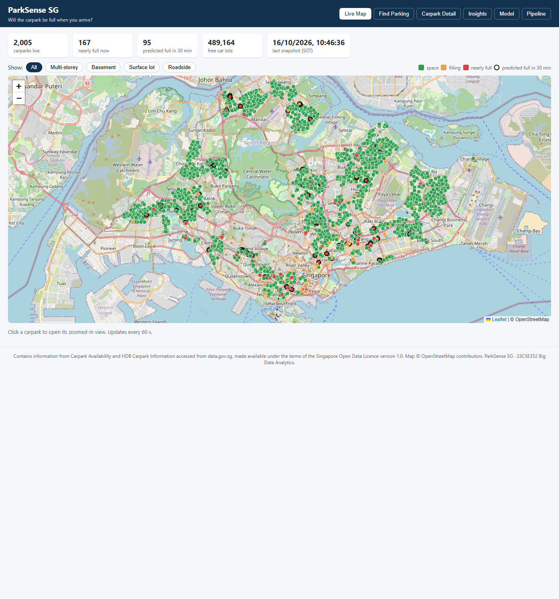
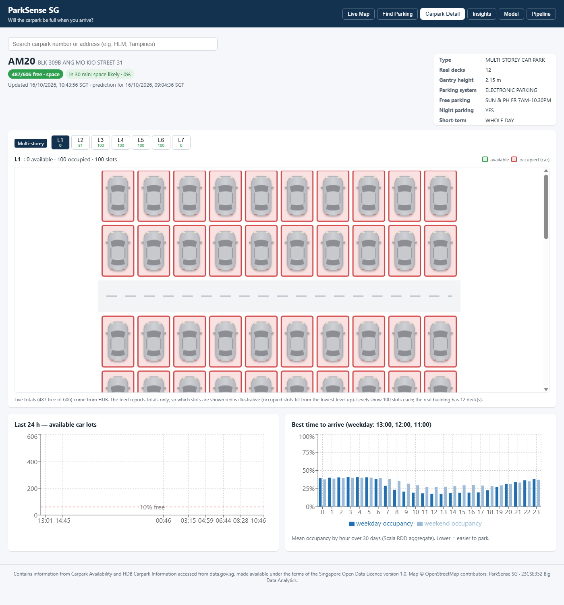
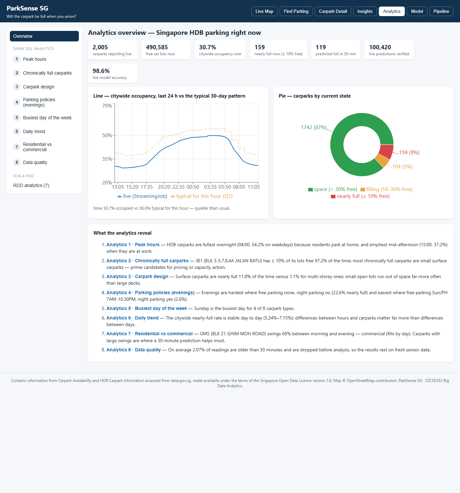
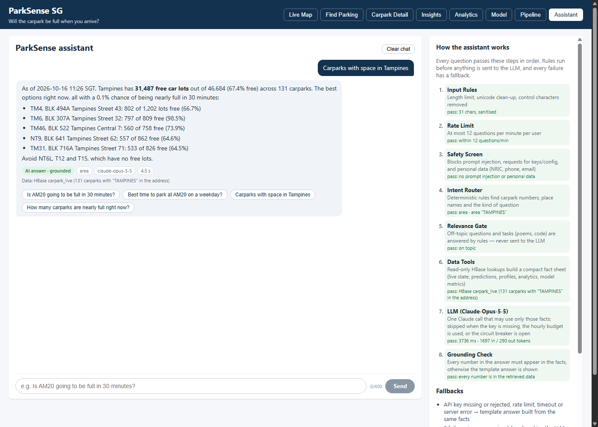

# ParkSense SG

**Will the carpark be full when you arrive?** ParkSense SG tracks about 2,000 Singapore HDB carparks in real time. For
each one it predicts whether the carpark will be **nearly full (at most 10% of car lots free) 30 minutes from now**.

It is an end-to-end big-data project. Open data comes from data.gov.sg every minute, lands in an HDFS data lake, is
cleaned by a Scala Spark RDD pipeline, analysed with Spark SQL, modelled with PySpark ML, served from HBase, and shown
in a React dashboard with a map, a zoomed carpark view, analytics pages and a chatbot that answers from the database.

> Course project: 23CSE352 Big Data Analytics, Project Review 3.
> Data: data.gov.sg *Carpark Availability* and *HDB Carpark Information*, Singapore Open Data Licence v1.0.

---

## Contents

1. [What you can see](#1-what-you-can-see)
2. [Key results](#2-key-results)
3. [Architecture](#3-architecture)
4. [Tech stack](#4-tech-stack)
5. [Repository layout](#5-repository-layout)
6. [How each part works](#6-how-each-part-works)
7. [Getting started](#7-getting-started)
8. [Configuration](#8-configuration)
9. [REST API](#9-rest-api)
10. [Troubleshooting](#10-troubleshooting)
11. [Documentation index](#11-documentation-index)
12. [Limitations](#12-limitations)

---

## 1. What you can see

The dashboard runs at **http://localhost:5000** and has eight tabs:

| Tab | What it shows |
|---|---|
| **Live Map** | every carpark at its real location, coloured green / amber / red by free space; a ring marks carparks predicted to be full in 30 min |
| **Find Parking** | click a destination: nearby carparks ranked by the chance of finding space on arrival |
| **Carpark Detail** | a zoomed view of one carpark. Multi-storey and basement carparks get one level tab per 100 lots; surface lots and roadside parking get their own layouts. Each bay is green (free) or red with a car (occupied). Also shows a 24-hour history chart and "best time to arrive" |
| **Insights** | the main findings in plain language |
| **Analytics** | an overview (live KPIs, line + pie charts) plus a page for each of the 8 Spark SQL analyses and the Scala RDD analyses, with charts, the exact SQL and the result table |
| **Model** | test-set and live metrics, confusion matrix, feature importance, model vs baselines |
| **Pipeline** | Spark statistics, caching / shuffle / partition experiments, streaming status |
| **Assistant** | a chatbot that answers questions from the live HBase data (see [6.8](#68-assistant-chatbot)) |

| Live map | Zoomed carpark (multi-storey) |
|---|---|
|  |  |

| Analytics overview | Assistant |
|---|---|
|  |  |

Map pins are the real carpark locations from HDB's dataset (converted from SVY21 to latitude/longitude). In the zoomed
view the free / occupied **counts** are the real live numbers, but which bay is filled is illustrative, because the feed
reports totals only.

---

## 2. Key results

Every number below is read from `outputs/`. Nothing is estimated.

**Data processed** (`outputs/metrics/rdd_summary.csv`)

| | |
|---|---|
| History window | 2026-09-15 → 2026-10-15 (31 days, 15-minute snapshots, 3,293 snapshots) |
| Raw input lines | 6,652,105 |
| Clean lot records after the Scala RDD pipeline | 7,851,051 (126,479 stale readings dropped) |
| Carparks | 2,000 in the history; 24 always-zero and 172 never-changing sensors excluded from ML |
| Model split (by day) | 22 train / 4 validation / 5 test days |

**Model, 30-minute horizon, test set** (`outputs/metrics/model_comparison.csv`, `transition_metrics.csv`)

| Model | Accuracy | Precision | Recall | F1 | PR-AUC |
|---|---|---|---|---|---|
| **Random Forest (deployed, threshold 0.89)** | 0.9852 | 0.8547 | 0.8657 | 0.8602 | **0.9428** |
| Gradient-Boosted Trees | 0.9847 | 0.8659 | 0.8396 | 0.8525 | 0.9315 |
| Persistence baseline ("as full as it is now") | 0.9867 | 0.8728 | 0.8737 | **0.8733** | 0.7783 |
| Historical baseline (carpark × hour × weekday rate) | 0.9734 | 0.7539 | 0.7330 | 0.7433 | 0.7834 |

**On overall F1 the model does not beat persistence**, because most carparks don't change state within 30 minutes.
Its value is in the **state changes**, which persistence always gets wrong (0%). The Random Forest predicts **31.8%** of all
changes correctly, and **40.0%** of the "becomes full" changes.

| Horizon | RF F1 | Persistence F1 |
|---|---|---|
| 15 min | 0.8900 | 0.9081 |
| 30 min | 0.8602 | 0.8733 |
| 60 min | 0.8265 | 0.8252 |

**Live verification**: every prediction is checked against what actually happened 30 minutes later
(`outputs/metrics/live_eval_summary.json`). This updates continuously; the figures here are from 2026-10-16 11:39 SGT.
107,506 predictions checked: model F1 0.8616 vs persistence 0.8760; 30.1% of 1,391 live state changes predicted correctly.

**Findings from the analytics** (`outputs/analytics/`)

- HDB carparks are fullest **overnight**. On weekdays the peak is 04:00 at 54.2% mean occupancy and the quietest hour is
  15:00 at 37.2%, because residents park at home.
- The most chronically full carpark, **JB1** (Jalan Batu), has ≤ 10% of its lots free 97.2% of the time.
- **Design matters**: electronic surface carparks are nearly full 11.85% of the time, compared with 1.10% for electronic
  multi-storey carparks.
- **Policy matters in the evening**: carparks with neither free nor night parking are nearly full 22.58% of evening
  readings, compared with 2.63% for carparks that allow both.

---

## 3. Architecture


```
data.gov.sg API ──► ingest/ (Python) ──► HDFS data lake  /parksense/raw/...
   (every 60 s live,       │                    │
    15-min history)        │                    ▼
                           │          Scala Spark RDD pipeline (RddPipeline.scala)
                           │                    │  Parquet /parksense/processed/...
                           │                    ▼
                           │      Spark SQL analytics · PySpark features + ML · Spark concepts experiments
                           │                    │
                           ▼                    ▼
              Scala Structured Streaming ──► HBase (carpark_live, carpark_history, predictions_log, metrics)
              + live scoring + verification          │  REST :8085
                                                     ▼
                                Express API (:5000) + React dashboard + Assistant (Claude)
```

- **Batch layer**: 31 days of history → HDFS → RDD cleaning → Parquet → analytics + model training.
- **Speed layer**: the poller writes a file every minute → `StreamingJob` updates HBase. Every 5 minutes `score_live.py`
  writes predictions, and `verify_live.py` checks old predictions against what happened.
- **Serving layer**: HBase row keys are designed for each UI query (see [6.6](#66-hbase-design)).
- A **watchdog** restarts any failed component (HDFS, HBase, Thrift, REST, poller, stream, scorer, verifier, UI).

Full write-up: [`docs/architecture.md`](docs/architecture.md).

---

## 4. Tech stack

| Layer | Technology (version used) |
|---|---|
| Storage | Hadoop HDFS 3.3.1 · HBase 2.5.15 (Thrift :9090, REST :8085) |
| Processing | Apache Spark 3.5.9 · Scala 2.12.18 (sbt 1.10.7) · PySpark ML · Spark SQL · Structured Streaming |
| Languages / runtimes | Java 8 (Hadoop/HBase daemons) and Java 11 (Spark) · Python 3.12 · Node.js 20 |
| Python libraries | pandas, numpy, pyarrow, requests, pyproj, happybase, matplotlib, seaborn (pinned in `requirements.txt`) |
| Web | Express 4 · React + Vite · Leaflet map · Recharts |
| Assistant | Anthropic Claude API (`@anthropic-ai/sdk`, model `claude-opus-5-5`) |
| OS | Ubuntu 24.04 on WSL2, single machine (`local[8]` Spark) |

---

## 5. Repository layout

```
parksense-sg/
├── config/config.yaml          every endpoint, path, threshold, interval and port (single source of settings)
├── ingest/                     Python data acquisition
│   ├── download_metadata.py    HDB carpark information (SVY21 → WGS84 with pyproj)
│   ├── backfill_history.py     31 days of 15-minute snapshots (rate-limited, resumable, 3 workers)
│   ├── live_poller.py          polls the API every 60 s → stream files + HBase
│   ├── flatten.py              shared one-line-per-carpark format used by every job
│   ├── hbase_io.py             HappyBase helpers (retry, one connection per operation)
│   └── common.py               rate-limited HTTP session, logging
├── spark-scala/                Scala Spark jobs (sbt project)
│   └── src/main/scala/parksense/
│       ├── RddPipeline.scala   core RDD pipeline: parse, flatMap, filter, combineByKey, reduceByKey, joins, accumulators
│       ├── SparkConcepts.scala caching, partitioning, shuffle (reduceByKey vs groupByKey), broadcast vs shuffle join
│       ├── StreamingJob.scala  Structured Streaming file source → foreachBatch → HBase
│       ├── HBaseWriter.scala   BufferedMutator writes inside foreachPartition
│       └── Records.scala, Config.scala, util/ (timers, stage metrics listener)
├── pyspark_jobs/
│   ├── analytics.py, analytics_queries.py   the 8 Spark SQL analyses (temp views on Parquet, no Hive)
│   ├── eda.py                  exploratory analysis + data-quality report
│   ├── features.py             15-min slot features (lags, rolling stats, train-only target encoding)
│   ├── train.py, evaluate.py   Random Forest / GBT vs persistence + historical baselines, threshold tuning
│   ├── perf_system.py          scalability, parallelism and shuffle-partition experiments
│   ├── score_live.py           live predictions every 5 min → HBase
│   ├── verify_live.py          checks past predictions against what happened
│   └── publish_metrics.py      pushes every result table to HBase `metrics` for the UI
├── hbase/create_tables.hbase   namespace `parksense` + 4 tables
├── scripts/                    every step as a shell script (see section 7)
├── ui/
│   ├── server/                 Express API on :5000 (reads HBase via REST, serves the React build)
│   │   ├── routes/             carparks, insights/analytics, metrics, health, chat
│   │   └── agent/              Assistant: guardrails, router, data tools, LLM, grounding check, fallbacks
│   └── client/                 React + Vite app (pages/, components/, layout.js for the zoomed carpark templates)
├── viz/                        make_figures.py (18 figures), fill_report.py (report draft filled from outputs/)
├── docs/                       report, architecture, data dictionary, fallbacks, chatbot design, demo, viva, screenshots
├── outputs/                    results: metrics/, analytics/, figures/, lineage/, logs/ (every number in the docs comes from here)
├── PROGRESS.md                 phase-by-phase build log, rubric coverage and recovery notes
└── requirements.txt
```

**Not in git** (see `.gitignore`):
- `data/` (raw and processed data, which you re-download; see section 7)
- `models/`
- `.env` (keys)
- `node_modules`, build outputs, Spark event logs
- the live files that grow every minute (poller / scorer / verifier logs, `live_predictions.csv`, `live_eval.csv`,
  `stream_batches.csv`); `live_eval_summary.json` keeps the live numbers

---

## 6. How each part works

### 6.1 Data acquisition (`ingest/`)
- **Metadata**: HDB carpark information (address, type, parking system, decks, gantry height, free / night parking).
  Coordinates are converted from SVY21 (EPSG:3414) to WGS84, and every point is checked to lie inside Singapore.
- **History**: `backfill_history.py` requests one snapshot every 15 minutes for 31 days, at most 4 requests per 10 seconds.
  It skips files already downloaded, so it can resume, and it retries the empty response the API returns at exactly
  00:00:00.
- **Live**: `live_poller.py` calls the API every 60 s and writes one file per poll for the streaming job and the HBase
  `carpark_live` / `carpark_history` tables.

### 6.2 Scala RDD pipeline (`RddPipeline.scala`)
`textFile → map(parse) → filter → flatMap(explode lots) → filter(stale > 30 min, total ≤ 0) → map(clean)`, with
accumulators counting every rejected record. Then key-value analytics:
- `combineByKey` for per-carpark min / max / mean / full rate
- `reduceByKey` for type × hour and daily rates
- `sortBy` / `take` for the top 20
- a broadcast join and a shuffle join with the metadata, timed against each other

The output is Parquet in HDFS.

### 6.3 Spark concepts (`SparkConcepts.scala`, `perf_system.py`)
Measured on this machine (`outputs/metrics/concepts_*.csv`, `perf_system.csv`):

| Experiment | Results |
|---|---|
| Caching | no cache 6,859 ms on the 2nd action; `MEMORY_ONLY` 222 ms; `MEMORY_AND_DISK` 165 ms |
| Shuffle | `reduceByKey` 2,102 ms and 7.3 MB written; `groupByKey` 4,561 ms and 50.6 MB |
| Joins | broadcast 1,831 ms; shuffle 9,179 ms |
| Scaling | features + training on 100% of carparks took 353 s; on 25%, `local[1]` took 201 s and `local[*]` 67 s |

### 6.4 Spark SQL analytics (`analytics.py`)
Eight numbered questions, run as SQL over temporary views:

| # | Question | Runtime |
|---|---|---|
| 1 | When are carparks fullest? Occupancy by hour, weekday vs weekend | 8.87 s |
| 2 | Which carparks are chronically full? (top 20) | 68.97 s |
| 3 | Does carpark design (type × parking system) matter? | 7.40 s |
| 4 | Do free / night-parking policies change evening demand? | 3.82 s |
| 5 | Busiest day of the week per carpark type | 8.54 s |
| 6 | Daily trend of the citywide nearly-full rate | 5.08 s |
| 7 | Residential vs commercial: evening vs morning swing | 8.53 s |
| 8 | Data quality: raw lines vs clean rows, stale rate per day | 13.61 s |

### 6.5 Machine learning (`features.py`, `train.py`, `evaluate.py`)
- **Label**: `available / total ≤ 0.10` at *t + 30 min*, for each carpark.
- **Features**: current occupancy and free ratio; lags at 15 / 30 / 60 / 120 min; 15- and 60-minute deltas; 1 h and 3 h
  rolling mean and standard deviation (all built over 15-minute slots with timestamp self-joins); hour (sin / cos), minute
  of day, day of week, and weekend / holiday flags; free-parking, night-parking and basement flags; number of decks; and
  **target encoding** of carpark × hour (× weekday). The encoding is computed on the training days only, to avoid leakage.
- **Split**: by whole days in time order (22 / 4 / 5). There is no random split, because neighbouring 5-minute rows are
  almost identical.
- **Models**: Random Forest and Gradient-Boosted Trees, with class weights and the threshold tuned on validation. They
  are compared with two baselines, *persistence* and *historical rate*. The Random Forest was deployed.
- **Live**: `score_live.py` rebuilds the same features from HBase history every 5 minutes, and `verify_live.py` scores each
  prediction once its target time has passed.

### 6.6 HBase design
Each table's row key is designed for one query:

| Query | Table | Row key | Column families |
|---|---|---|---|
| latest state + prediction of every carpark | `carpark_live` | `carpark_no` | `s` state, `p` prediction, `m` metadata |
| one carpark's last 24 h | `carpark_history` | `carpark_no#<Long.MAX − epoch_ms>` (newest first) | `s` (TTL 14 days) |
| was a prediction right? | `predictions_log` | `carpark_no#<target_epoch_ms>` | `p` prediction, `a` actual |
| dashboard metric | `metrics` | metric name, e.g. `model:comparison` | `v` JSON |

### 6.7 Dashboard (`ui/`)
- **Server**: Express reads HBase through the REST gateway and serves the React build.
- **Carpark templates**: each carpark is mapped to one template in `ui/client/src/layout.js`:
  - multi-storey (one level per 100 lots)
  - basement (B-levels)
  - surface
  - roadside (fewer than 60 lots)
- **Deep links**: `#carpark/AM20`, `#analytics/3`, `#analytics/rdd`, `#assistant/ask/<question>`.

### 6.8 Assistant (chatbot)
Rules run **before** anything is sent to the LLM, and every failure has a fallback.
```
input rules → rate limit → safety screen → intent router → relevance gate → HBase data tools → Claude → grounding check
```
- **Rules first**: the input is cleaned and length-checked. It is screened for prompt injection and personal data (NRIC,
  phone, email). Off-topic questions and tasks such as poems or code are answered by rules and never reach the API.
- **Code chooses the data**: a deterministic router finds carpark numbers, place names and the type of question. Read-only
  HBase lookups then build a small fact sheet.
- **Grounded answer**: Claude may use only those facts, and **every number in its answer must appear in them**. If one
  doesn't, a template answer built from the same facts is shown instead.
- **Fallbacks**: a missing or invalid key, rate limit, timeout, server error, refusal or cut-off answer all lead to the
  template "offline answer". A circuit breaker and an hourly call budget protect the key. If HBase is down, the assistant
  says so instead of guessing.

Details and the test log: [`docs/chatbot.md`](docs/chatbot.md).

---

## 7. Getting started

### 7.1 Prerequisites
The scripts assume a single Linux machine (tested on Ubuntu 24.04 / WSL2) with user `hduser` and these locations. If
yours differ, edit [`scripts/env.sh`](scripts/env.sh).

| Component | Expected location |
|---|---|
| Hadoop 3.3.x (HDFS, pseudo-distributed) | `/usr/local/hadoop` |
| HBase 2.5.x | `~/hbase` |
| Spark 3.5.9 (Scala 2.12) | `~/tools/spark` |
| sbt 1.10.x | `~/tools/sbt` |
| Node.js 20 | `~/tools/node` |
| Java 8 (Hadoop/HBase) and Java 11 (Spark) | `/usr/lib/jvm/...` |
| Python 3.12 | system |

Recommended: 10 GB RAM for WSL (`.wslconfig`) and about 10 GB of free disk.

### 7.2 One-time setup
```bash
git clone https://github.com/NutZz1/ParkSense.git ~/parksense-sg && cd ~/parksense-sg
scripts/01_setup_python.sh          # Python venv ~/parksense-venv + requirements
source scripts/env.sh               # sets JAVA_HOME, SPARK_HOME, HADOOP/HBASE paths, venv, and loads .env
cp -n .env.example .env             # then edit: ANTHROPIC_API_KEY (Assistant), optional DATAGOV_API_KEY
chmod 600 .env
scripts/02_start_services.sh        # HDFS, HBase, Thrift :9090, REST :8085 (info UI :8086)
scripts/00_check_env.sh             # writes outputs/logs/env.txt (versions + compatibility check)
scripts/04_hbase_create_tables.sh   # namespace parksense + 4 tables
scripts/build_scala.sh              # sbt package -> Scala jar
```

### 7.3 Get the data (not stored in git)
```bash
python ingest/download_metadata.py                                   # HDB carpark information
nohup python ingest/backfill_history.py --days 30 > outputs/logs/backfill.out 2>&1 &   # ~2 h, resumable
scripts/03_hdfs_layout.sh                                            # upload to HDFS (re-runnable)
```

### 7.4 Run the batch pipeline
```bash
scripts/run_batch.sh                # RddPipeline -> SparkConcepts -> analytics -> features -> EDA -> train
                                    #   -> evaluate -> perf -> publish to HBase -> figures -> report
scripts/run_batch.sh --skip-perf    # faster (skips the performance experiments)
scripts/run_batch.sh --from "6 train"   # resume from a numbered step after a failure
scripts/run_scala.sh RddPipeline    # run one Scala job on its own
scripts/start_history_server.sh     # Spark History Server at http://localhost:18080 (DAGs, stages)
scripts/demo_rdd.sh                 # ~20 s read-only RDD demo (creation, transformations, actions, key/value) for one day
```

### 7.5 Start the live layer and the dashboard
```bash
scripts/build_ui.sh                 # once: npm install + vite build
scripts/start_live.sh               # poller + StreamingJob + scoring + verification + UI
scripts/watchdog.sh start           # auto-restart anything that fails (log: outputs/logs/watchdog.log)
```
Then open **http://localhost:5000**.

Useful commands:
```bash
scripts/watchdog.sh status          # what is running
scripts/start_live.sh ui            # start only the UI (also: poller, stream, score, verify)
scripts/stop_live.sh                # stop the live layer (stop_live.sh ui stops just the UI)
python pyspark_jobs/verify_live.py && python viz/make_figures.py && python viz/fill_report.py   # refresh live results
```

---

## 8. Configuration

- **`config/config.yaml`**: every tunable value:
  - API endpoints and rate limit
  - HDFS / local paths (`paths.use_hdfs: false` runs without HDFS)
  - the nearly-full threshold (`full_ratio: 0.10`) and prediction horizon (`horizon_min: 30`)
  - stale-reading limit, poll interval, HBase ports, Spark master / memory / partitions
- **`.env`** (git-ignored, copy from `.env.example`):

| Variable | Purpose |
|---|---|
| `ANTHROPIC_API_KEY` | Claude API key for the Assistant. Without it, the Assistant gives template answers only |
| `DATAGOV_API_KEY` | optional data.gov.sg key (higher rate limits) |
| `HBASE_REST` | HBase REST URL used by the UI (default `http://localhost:8085`) |
| `CHAT_MODEL`, `CHAT_MAX_LLM_PER_HOUR` | optional: Assistant model (default `claude-opus-5-5`) and hourly call budget (default 200) |

---

## 9. REST API

All endpoints are served by `ui/server` on port 5000.

| Method & path | Returns |
|---|---|
| `GET /api/health` | HBase status and the latest stream batch |
| `GET /api/carparks` | every carpark: live state, prediction, metadata |
| `GET /api/carparks/:id` | one carpark |
| `GET /api/carparks/:id/history?hours=24` | readings over the last *n* hours (max 14 days) |
| `GET /api/carparks/:id/profile` | typical occupancy by hour, weekday and weekend |
| `GET /api/nearby?lat=&lon=&radius=800` | nearby carparks ranked by predicted space on arrival |
| `GET /api/analytics` | Spark SQL Q1–Q8 (question, SQL, runtime, rows) + Scala RDD analytics |
| `GET /api/analytics/live-series` | citywide occupancy, last 24 h (5-minute buckets) |
| `GET /api/insights` | data behind the Insights tab |
| `GET /api/metrics/model` · `/live` · `/spark` · `/stream` | model, live-evaluation, Spark and streaming metrics |
| `POST /api/chat` `{message, history}` | Assistant answer with its path, sources and step trace |
| `GET /api/chat/status` | Assistant LLM status (configured, circuit breaker, calls this hour) |

---

## 10. Troubleshooting

| Problem | Fix |
|---|---|
| UI shows "HBase REST unavailable" | `scripts/02_start_services.sh`, or let `scripts/watchdog.sh start` restart it |
| REST won't start: "Address already in use" | the REST info UI also defaults to 8085; the script starts it with `--infoport 8086` |
| Spark job runs out of memory | lower `spark.master` / raise `driver_memory` in `config.yaml`; give WSL more RAM in `.wslconfig` |
| A batch step failed halfway | `scripts/run_batch.sh --from "<step>"` resumes from that step |
| Assistant says "Offline answer" | check `ANTHROPIC_API_KEY` in `.env` and `GET /api/chat/status`; restart the UI after editing `.env` |
| No HDFS available | set `paths.use_hdfs: false` in `config.yaml` to read and write local files |

More: [`docs/fallbacks.md`](docs/fallbacks.md) and the *Recovery* section of [`PROGRESS.md`](PROGRESS.md).

---

## 11. Documentation index

| File | Contents |
|---|---|
| [`PROGRESS.md`](PROGRESS.md) | build log for phases 0–10, rubric coverage (with file:line references), incidents, recovery |
| [`docs/analysis_question.md`](docs/analysis_question.md) | the problem, the target definition and why 30 minutes |
| [`docs/data_dictionary.md`](docs/data_dictionary.md) | every field in the raw, processed and HBase data |
| [`docs/data_quality_report.md`](docs/data_quality_report.md) | generated data-quality findings |
| [`docs/architecture.md`](docs/architecture.md) | architecture, technology choices, HBase design |
| [`docs/dag_explanation.md`](docs/dag_explanation.md) | Spark DAGs, stages and shuffles explained |
| [`docs/chatbot.md`](docs/chatbot.md) | Assistant agent design, fallbacks and test log |
| [`docs/fallbacks.md`](docs/fallbacks.md) | what to do when a component fails |
| [`docs/report_draft.md`](docs/report_draft.md) | project report, filled from `outputs/` by `viz/fill_report.py` |
| [`docs/slides_outline.md`](docs/slides_outline.md), [`docs/demo_script.md`](docs/demo_script.md) | presentation and live-demo script |
| [`docs/viva_notes.md`](docs/viva_notes.md) | 33 likely viva questions with answers |
| [`outputs/figures/`](outputs/figures) | 18 figures (architecture, heatmaps, model comparison, benchmarks, live evaluation) |

---

## 12. Limitations

- One month of history, with no public holidays in the window. HDB carparks only.
- Some sensors report stale or frozen values. They are filtered out or excluded, but this reduces coverage.
- The model beats persistence on state changes, not on overall F1. Live verification covers hours, not weeks.
- It runs on a single machine (pseudo-distributed HDFS, local Spark). On a real cluster you would need more HBase region
  servers with pre-split regions, and a message queue such as Kafka instead of the file stream.
- In the zoomed carpark view, bay positions are illustrative; only the counts are real.
