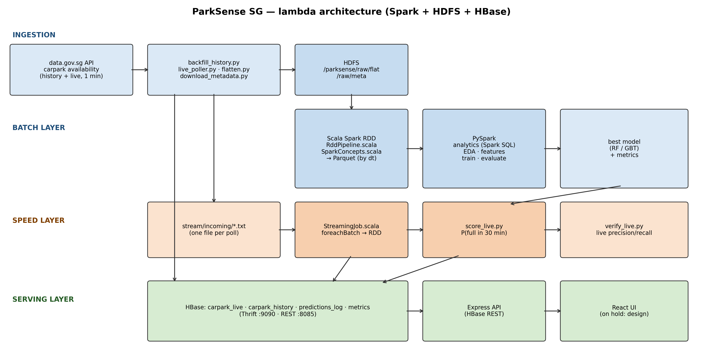

# Architecture

| Layer | Components |
|---|---|
| Ingestion | `download_metadata.py` (SVY21→WGS84), `backfill_history.py` (15-min grid, resumable, ≤ 4 req/10 s, 3 workers), `live_poller.py` (60 s), `flatten.py` (shared line format) |
| Batch | HDFS `/parksense/raw/...` → `RddPipeline.scala` (RDD API) → Parquet `/parksense/processed/occupancy` + `agg_*`; `SparkConcepts.scala`; `analytics.py` (Spark SQL temp views, no Hive); PySpark EDA/features/train/evaluate |
| Speed | `StreamingJob.scala` (file stream → `foreachBatch` → RDD ops → HBase via `BufferedMutator` in `foreachPartition`); `score_live.py`; `verify_live.py` |
| Serving | HBase tables below; Thrift :9090 (HappyBase, Python), REST :8085 (Express); React UI on hold until the design is approved |

## Why each technology
| Tech | Role | Why |
|---|---|---|
| HDFS | data lake | distributed, fault-tolerant storage that Spark reads in parallel |
| Spark (Scala, RDD) | batch + stream processing | rubric requirement; low-level control of keys, partitions, caching, lineage |
| PySpark MLlib | distributed ML | pipelines scale with the data |
| HBase | NoSQL serving store | millisecond lookups by row key (a carpark's latest state, its last 24 h); handles the stream's write rate; continuity with Review 2 |
| Express + React | full-stack app | the team knows MERN; turns predictions into a product |

**Why HBase and not Hive:** the app needs point lookups ("what is carpark HLM's state now and over the last 24 h"), which
is what HBase's row-key design is built for. The big analytical scans run once in Spark and their results are stored in
HBase for the dashboard, so a separate SQL warehouse is not needed. Hive was used in Review 1.

## HBase design (queries → row keys → column families)
| Access pattern | Table | Row key | Families |
|---|---|---|---|
| A1 latest state + prediction of every carpark (map, every minute) | `carpark_live` | `carpark_no` | `s` state (every minute), `p` prediction (every ~5 min, other process), `m` static metadata |
| A2 one carpark's last 24 h (detail chart) | `carpark_history` | `carpark_no#<Long.MAX − epoch_ms, 19 digits>` | `s` (VERSIONS 1, TTL 14 days) |
| A3 was a prediction right? (live evaluation) | `predictions_log` | `carpark_no#<target_epoch_ms>` | `p` written at prediction time, `a` actuals written later |
| A4 dashboard metric X | `metrics` | metric name, e.g. `model:comparison` | `v` json + updated_at |

* The reversed timestamp sorts newest first, so "last 24 h" is a short forward scan from the prefix `HLM#`.
* The carpark prefix keeps one carpark's rows together; writes spread over ~2,000 prefixes, so no salting is needed.
  A `timestamp#carpark` key was rejected: every minute's writes would hit one region and one carpark's history would
  need a full scan.
* Families split by update rate and lifetime (each family is stored and configured separately); names are 1 letter
  because every family/qualifier name is stored with every cell. Compression: NONE (Snappy not verified on this machine).

## Integration decisions
1. Spark reads/writes plain Parquet on HDFS; Spark SQL uses temp views (no metastore).
2. Spark → HBase uses the plain client API (`ConnectionFactory`, `BufferedMutator`) inside `foreachPartition`;
   the shaded HBase client (`hbase mapredcp`) is passed with `--jars`, and `hbase-site.xml` with `--files`.
3. Python → HBase uses HappyBase over Thrift; a connection is opened per operation because the Thrift server drops idle
   sockets after ~60 s.
4. Express → HBase via the REST server (`-p 8085 --infoport 8086`); REST values are base64 and must be decoded.
5. Everything runs without HDFS (`paths.use_hdfs: false`) — see `fallbacks.md`.
